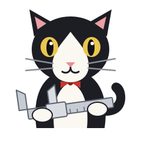

<p align="center"></p>

# Calipurr

Measure twice, purr once.

Calipurr helps you and your AI agent agree on real-world geometry for 3D printing, CNC routing and laser cutting. It remembers what your machines can actually do, and it records whether each number was measured or just assumed. It works with any agent that has shell access, and with no agent at all.

**Status:** early and unpublished. Everything below works, but it has only been tried on a few parts so far.

## Try it

From a clone of this repo, in a folder with an STL or a photo:

```
uv run --project /path/to/calipurr calipurr serve
```

That opens Emily's visual interface in your browser. It only listens on your own computer.

| In the GUI | Plain label | What it does |
|---|---|---|
| Cat tree | Project stages | Emily climbs as the project moves from Measure to Model, Check and Make |
| Food bowl | Measurements needed | Answer questions, and mark each answer measured or assumed |
| Yarn ball | Rotate | Turn the model |
| Laser dot | Point at this | Pin a comment to a spot on a model or photo. Click a dot again or use its x to remove it |
| Paw | Pick a step | Click the gauge step that fit |
| Report card | Test results | Records which step fit and what it measured |
| Collar tag | Machine | Choose which machine to check against |
| Cardboard box, whiskers, hairball | Fit, clearance, problems | The results of the pre-flight checks |
| Nine lives | Version history | Go back to earlier values |
| Litter box | Discarded | Set files aside and rescue them later |

Agents and people share the same plain files, so changes from either side show up in the open page:

```
params.toml        dimensions, each needed, assumed or measured
annotations.json   laser dots
kittens/           test pieces and what each one proved
litter/            discarded files
```

## Kittens: small test pieces

A kitten is a small print that answers one question before you commit to the whole part.

```
calipurr meow plug_od --name "Plug diameter" --ask "What fits inside the tube?"
calipurr kitten gauge --from 20.3 --to 21.1 --for plug_od --name tube-plug
calipurr kitten report tube-plug --step D --measured 20.75 --material PLA
calipurr kitten cut part.stl --keep-above 139 --name hose-port
```

Gauges get a recessed letter on each step. A is the step that gets reached first, which is the tip of a plug or the mouth of a socket. The value saved is the step's modeled size, because that's the number that printed to fit. Your caliper reading records the printer's offset, and it warns you if the reading doesn't match the step you picked.

To rebuild the model whenever a value changes, have your build script read `params.toml` and start the GUI with `calipurr serve --build "python build.py"`.

## Pre-flight checks

`calipurr purrflight part.stl --machine my-printer` checks for a closed solid, bed contact, overhangs, and fit on the machine. Its warnings point at things worth checking in your slicer. A clean result can't promise a good print, and a warning doesn't mean a print will fail.

## Machines

```
calipurr adopt my-router --kind cnc
calipurr hungry my-router
calipurr feed my-router travel_z_mm 90 --note "measured with router installed"
```

Profiles are saved in `~/.config/calipurr/machines/`, so they stay on your computer and survive upgrades. Calipurr ships no default machine values, because a borrowed number can break a bit or start a fire. It keeps asking until you supply them.

## Commands

| Command | Plain alias | Job |
|---|---|---|
| `serve` | `gui` | Open the visual interface |
| `adopt` | `add` | Add a machine |
| `litter` | `list` | List machines |
| `vet` | `show` | Show a machine's values and where they came from |
| `feed` | `set` | Record a machine value, with `--assumed` for guesses |
| `hungry` | `missing` | List machine values still needed (exits 1 if any are) |
| `meow` | `ask` | Ask for a part dimension |
| `bowl` | `params` | List part dimensions (exits 1 if any are needed) |
| `treat` | `answer` | Record a part dimension |
| `dots` | `comments` | Read laser dot comments |
| `kitten` | `test-piece` | Make gauges and cutouts, and report results |
| `purrflight` | `check` | Check a model before making it (exits 1 on a failure) |

Add `--json` to most commands for agent-friendly output.

## Use it with your agent

`skills/calipurr/` is an [Agent Skill](https://agentskills.io). Copy it to wherever your agent keeps skills. If your agent doesn't support skills, point it at `skills/calipurr/SKILL.md`.

## Safety

Calipurr doesn't make machines safe. Check its output yourself, and never leave a running laser or router unattended.

## About the mascot

Emily is named for Emily Warren Roebling (1843-1903). When caisson disease left her husband, chief engineer Washington Roebling, bedridden during construction of the Brooklyn Bridge, she relayed information between him and his assistants and reported the progress of the work back to him. Through that work she developed an extensive knowledge of strength of materials, stress analysis and catenary curves.

She later earned a law certificate from New York University and published "A Wife's Disabilities," an essay arguing for women's rights. Emily the cat takes on a small version of her role on the bridge, carrying accurate information between the people who measure things and the tools that design and make them.

## Development

```
uv run --group dev pytest              # everything except the browser tests
uv run --group e2e pytest tests/e2e    # drives the real GUI in Chrome
```

The GUI bundles [three.js](https://threejs.org) (MIT) so it works offline.

## License

[GPL-3.0-or-later](LICENSE)
